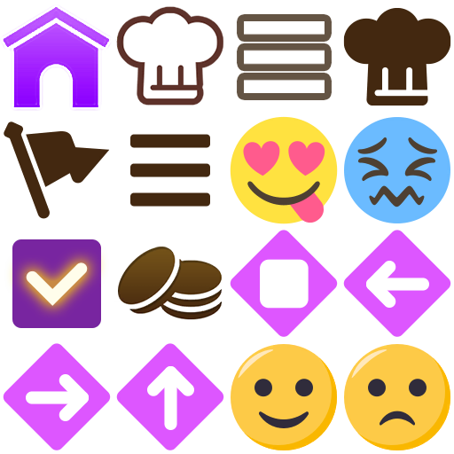

# Server news using emoji

## Adding built-in pictures to news

Edit an entry's `Content` directly in
`src/offline_responses/api/news/list.json`. The news viewer supports indexed
sprite markup, for example:

```json
"Content": "Welcome! <sprite=1><br>Completed <sprite=8>"
```

`<sprite=N>` selects a registered picture from the viewer's default sprite
asset. `<br>` adds a line break. Put the tags directly in the JSON string;
do not HTML-escape their angle brackets.

The [example notice](examples/news-sprites.json) demonstrates all 14 registered
indices. To try it, append the example object to the `News` array in your local
News JSON, preserving existing notices. Give it a unique `NewsId` and adjust
`StartAt` and `EndAt` (Unix seconds) to a suitable publication window. Verify
changes by opening the example notice in the Android client; visibility and
rendering remain client-dependent.

### EmojiOne atlas



The exported `EmojiOne` metadata defines indices **0–13**, even though its
512 × 512 texture contains 16 image cells. The final two cells (smiling and
sad faces, bottom row) have no registered entries; indices 14 and 15 do not
display pictures in the client test.

| Index / tag | Picture or region in the atlas |
| --- | --- |
| `<sprite=0>` | Home purple |
| `<sprite=1>` | Cooking light |
| `<sprite=2>` | Menu light |
| `<sprite=3>` | Cooking dark |
| `<sprite=4>` | Guilds dark  |
| `<sprite=5>` | Menu dark |
| `<sprite=6>` | Cooking yummy |
| `<sprite=7>` | Cooking distressed |
| `<sprite=8>` | Check mark |
| `<sprite=9>` | Shop dark |
| `<sprite=10>` | Stop |
| `<sprite=11>` | Left arrow |
| `<sprite=12>` | Right arrow |
| `<sprite=13>` | Up arrow |
| `<sprite=14>` | Can not be used |
| `<sprite=15>` | Can not be used |

Arbitrary external pictures are not loaded by these tags. The HTML
`` displays literal markup. Other named sprite assets are
not yet confirmed usable in news.
